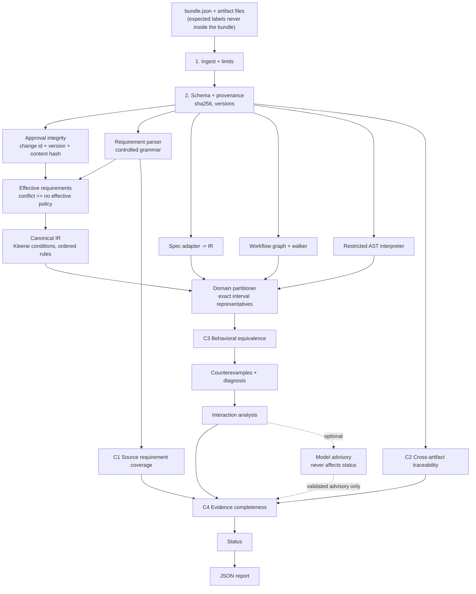

# VerityFlow — Implementation Plan

Status: **Stage 3 complete (awaiting review)**. Revision 4 (2026-11-18). Revision 3 covered the approved Stage 2 plan. Stage 1 completed in `04d9ea6`; the deterministic reviewer (steps 1–8) and `verityflow review` are tagged `stage2-baseline` (`4702939`); the Stage 2 status correction is `f0dbb0c`. Stage 3 (supplementary model layer) is implemented per §15; Stage 4 has not started.

Revision history:
- Rev 1 (2026-11-17): initial plan.
- Rev 2 (2026-11-17): approval binding and conflict-integrity rules (§6); explicit three-valued logic (§3.6); four independent review check families (§8); conservative Python subset v1 with a separate ERROR outcome (§5); exact partition-representative construction and INCOMPLETE-on-limit rule (§7); evaluation-integrity rules with frozen inputs and inaccessible labels (§11); explicit parsing of the assignment's starter wording and OTHERWISE semantics (§4); setup authorization recorded.
- Rev 3 (2026-11-17): `trace_map` is optional and acts only as a validated hint (§3.3, §8.2); cross-artifact correspondence is inferred from canonical semantics (conditions, fields, units, destinations, precedence, exceptions); ambiguous correspondences are coverage gaps, never arbitrary choices; matching IDs never establish equivalence and renames never cause behavioral mismatches. Continuous partitioning now distinguishes adjacent-representable-value domains, continuous rational domains with witnesses in every open interval, and explicit bounded/unbounded ends (§7).
- Rev 4 (2026-11-18): Stage 3 implemented as a strictly advisory model layer (§15). Model defaults live in code so the sealed Stage 2 config hash is untouched (D-042); observations are classified as assisted, unverified or rejected with no model-to-blocker bridge (D-043); evidence validation requires exact supplied quotations (D-044).

---

## 0. Workspace state at planning time (2026-11-17)

| Item | Observed |
|---|---|
| `D:\Shodh AI` | Empty directory, no files (verified before `git init`) |
| Git | `git` 2.55 installed; repository initialized during P0 |
| Python | Only 3.11.9 on PATH before setup; 3.12 installed via `uv` in P0 |
| `uv` | 0.12.18 — used to install 3.12, pin it, and produce `uv.lock` |
| Prior user work | None existed; the only files created by this work are under `docs/`, plus the P0 scaffold |

P0 setup is authorized: `git init` in this verified-empty workspace, `uv python install 3.12`, pinning 3.12, CPython differential tests restricted to repository-authored snippets, and an optional provider-neutral real-model adapter with Gemini as a configurable implementation, disabled by default.

---

## 1. Architecture

Deterministic-first hybrid. Everything above the model node is pure, offline and model-free; the model is an advisory side-channel that cannot change the status. Four check families are evaluated independently and combined only at the status step.



### 1.1 Module map

| Pipeline step | Module |
|---|---|
| Ingest, limits | `verityflow.ingest.loader`, `verityflow.ingest.limits` |
| Schema/provenance | `verityflow.models.*` (Pydantic), `verityflow.ingest.provenance` |
| Requirement grammar | `verityflow.requirements.lexer`, `.parser`, `.lexicon` |
| Approvals | `verityflow.approvals.resolver` |
| Effective requirements + IR | `verityflow.ir.model`, `.compile`, `.units`, `.evaluate` |
| Coverage / traceability | `verityflow.verify.coverage`, `.traceability` |
| Spec / workflow / Python | `verityflow.artifacts.spec`, `.workflow`, `verityflow.pyast.*` |
| Partition/equivalence | `verityflow.verify.partition`, `.equivalence` |
| Counterexamples/diagnosis | `verityflow.verify.counterexample`, `.diagnose` |
| Interaction | `verityflow.verify.interaction` |
| Model | `verityflow.model.client` (Protocol), `.fake`, `.gemini` (optional), `.prompt`, `.validate` |
| Evidence/status/report | `verityflow.report.evidence`, `.status`, `.builder` |
| CLI | `verityflow.cli` (Typer) |

### 1.2 Principles

1. **The behavioral verdict is concrete.** A behavioral defect exists only when a specific in-domain ticket produces a different outcome. Cross-artifact IDs never decide behavioral correctness.
2. **Behavior is not the only source of findings.** Source coverage, traceability and evidence completeness are independent required checks (§8). Missing requirements are reported even when their IDs are absent from every target artifact.
3. **Different IDs are legitimate.** A target element may map to a requirement through an explicit semantic mapping (bundle `trace_map` artifact) instead of a shared ID; the mapping is validated for evidence but never trusted for behavior.
4. **No silent inventing.** Unsupported or ambiguous content becomes a disclosed coverage gap, never a guess and never a silent drop.

---

## 2. Proposed repository structure

```
D:\Shodh AI\
├── pyproject.toml              # Python 3.12, deps, ruff, mypy, pytest config
├── uv.lock                     # pinned lockfile
├── .python-version             # 3.12 (uv pin)
├── README.md
├── src/verityflow/
│   ├── __init__.py
│   ├── cli.py
│   ├── config.py
│   ├── logging_setup.py
│   ├── models/                 # Pydantic data contracts
│   ├── ingest/
│   ├── requirements/
│   ├── approvals/
│   ├── ir/
│   ├── artifacts/
│   ├── pyast/
│   ├── verify/
│   ├── model/
│   └── report/
├── schemas/                    # JSON Schema exported from Pydantic (committed)
├── configs/
│   ├── default.toml            # limits, authorized approver roles, unit table
│   ├── eval.toml               # frozen evaluation settings (hashed in reports)
│   └── model.toml              # provider settings (no secrets)
├── fixtures/
│   ├── dev/                    # B01, B03, B05, B06, B07–B09 (bundle dirs only; no labels here)
│   └── dev_evidence/           # frozen H01–H05 evidence (see execution note)
├── holdout/                    # sealed; not read by the reviewer
│   ├── MANIFEST.sha256         # hashes of every reserved file
│   ├── GENERATION.json         # generator hash + implementation checkpoint
│   ├── bundles/                # F01–F05 (claims triage)
│   └── labels/                 # expected Stage 1 outputs, outside bundle dirs
├── tests/
│   ├── unit/
│   ├── integration/
│   ├── regression/
│   ├── metamorphic/
│   ├── security/
│   └── differential/           # repo-authored snippets only
├── scripts/
│   ├── export_schemas.py
│   ├── run_eval.py             # --impl <git-ref> --split <dev|holdout|all>
│   ├── compare_reports.py      # baseline vs final on identical inputs/settings
│   ├── naive_baseline.py
│   └── oracle/                 # independent hand-written routing functions
├── reports/
│   ├── baseline/
│   ├── final/
│   └── ablation/
└── docs/
    ├── implementation_plan.md
    ├── architecture.md
    ├── supported_language.md
    ├── decision_log.md
    ├── evaluation_protocol.md
    ├── limitations.md
    └── debugging_log.md
```

Labels deliberately live outside bundle directories so `verityflow review <bundle>` cannot see them; the evaluation harness joins them by bundle ID.

---

## 3. Data contracts (Pydantic v2, `extra="forbid"`, frozen)

### 3.1 Bundle manifest — `bundle.json`

The manifest is the only trusted source of approval authority, and approvals are cryptographically bound to the change content they approve.

```json
{
  "bundle_id": "B03",
  "bundle_version": "1",
  "review_target": {"requirements": ["REQ@1.0"], "spec": "SPEC@2", "workflow": "WF@3", "code": ["PY-ROUTER@1.4"]},
  "artifacts": [
    {"artifact_id": "REQ", "version": "1.0", "kind": "requirements", "path": "requirements.md", "sha256": "..."},
    {"artifact_id": "DICT", "version": "1", "kind": "data_dictionary", "path": "dictionary.json", "sha256": "..."},
    {"artifact_id": "CHG", "version": "1", "kind": "change_requests", "path": "changes.json", "sha256": "..."},
    {"artifact_id": "TRACE", "version": "1", "kind": "trace_map", "path": "trace.json", "sha256": "..."},
    {"artifact_id": "SPEC", "version": "2", "kind": "spec", "path": "spec.json", "sha256": "..."},
    {"artifact_id": "WF", "version": "3", "kind": "workflow", "path": "workflow.json", "sha256": "..."},
    {"artifact_id": "PY-ROUTER", "version": "1.4", "kind": "python", "path": "router.py", "sha256": "...",
     "link": {"entrypoint": "route", "param": "ticket",
              "field_map": {"wait_time": {"field": "wait_time", "unit": "seconds"}},
              "destination_map": {"ESC": "escalation_queue"}}}
  ],
  "approvals": [
    {"approval_id": "A1", "change_id": "C1", "change_version": "1",
     "change_sha256": "sha256:<hash of the exact change payload>",
     "decision": "approve", "approver_id": "u-17", "approver_role": "policy_owner",
     "recorded_at": "2026-10-02T09:00:00Z", "supersedes": []}
  ]
}
```

Validation: every path exists and is contained in the bundle directory; sha256 matches; `(artifact_id, version)` unique; `review_target` references exist; unknown keys rejected. Each validation failure is a finding, never a crash.

### 3.2 Data dictionary (versioned artifact)

```json
{
  "fields": [
    {"name": "category", "type": "string", "nullable": true, "domain": null},
    {"name": "priority", "type": "string", "nullable": true, "domain": ["low", "normal", "urgent"]},
    {"name": "wait_time", "type": "integer", "unit": "minutes", "min": 0, "max": 100000, "nullable": true},
    {"name": "vip", "type": "boolean", "nullable": true},
    {"name": "amount", "type": "decimal", "unit": "usd", "scale": 2, "min": "0.00"}
  ],
  "destinations": [{"id": "manual_review", "aliases": ["manual review"]},
                   {"id": "escalation_queue", "aliases": ["escalation queue", "escalation"]}],
  "aliases": {"waiting": "wait_time", "wait": "wait_time"},
  "named_predicates": {"urgent ticket": {"kind": "eq", "field": "priority", "value": "urgent"}}
}
```

The lexicon (aliases, named predicates, destination aliases) is data, so the starter text parses without hardcoding and unseen domains work unchanged. Keyword matching is case-insensitive; string literals are not.

### 3.2.1 Trace map (optional artifact, hint only)

```json
{
  "trace_map_id": "TRACE", "version": "1",
  "requirement_to_spec":     {"R3": ["S-ESC"]},
  "requirement_to_workflow": {"R3": ["n2.b0"]},
  "requirement_to_code":     {"R3": ["route"]},
  "supplemental":            {"spec": [], "workflow": [], "code": []}
}
```

- **Optional.** Coverage and correspondence are inferred from canonical semantics when no map is supplied.
- **Hint, not authority.** A hint narrows the candidate set for a requirement but is only accepted if the hinted element is still semantically equivalent (condition, fields, normalized units, destination, exception relationship); otherwise it is rejected as `INVALID_TRACE_HINT` (`COVERAGE_GAP`) and inference proceeds without it.
- **Validated.** Every referenced requirement and element must exist in the declared artifact versions; dangling references are `MISSING_EVIDENCE`.
- **IDs never decide equivalence.** Matching IDs do not create a match, and renamed IDs do not remove one.

### 3.3 Change requests (versioned, **untrusted** content)

```json
{"changes": [{
  "change_id": "C1", "change_version": "1",
  "base_artifact": "REQ", "base_version": "1.0", "target_rule": "R3",
  "operation": "replace_threshold",
  "from": {"value": 30, "unit": "minutes"}, "to": {"value": 25, "unit": "minutes"},
  "sequence": 1, "rationale": "free text, never interpreted as authority"
}]}
```

`change_version` is immutable once created. The approval-binding hash is SHA-256 over the *canonical JSON* of the exact change object (sorted keys, `(",", ":")` separators, UTF-8, no NaN), so any payload change — including changing `change_version` — changes the hash and invalidates earlier approvals. Operations: `replace_threshold`, `replace_operator`, `replace_destination`, `replace_condition`, `add_rule` (with `after`), `remove_rule`. `from` must match the current base value or the change is stale (§6).

### 3.4 Structured spec

```json
{"spec_id": "SPEC", "version": "2",
 "rules": [{"id": "S-ESC", "priority": 3, "implements": ["R3"],
            "when": {"kind": "cmp", "field": "wait_time", "op": ">=", "value": 30, "unit": "minutes"},
            "destination": "escalation_queue"}],
 "default": {"destination": "normal_queue", "implements": ["R4"]}}
```

Order is the explicit `priority` integer; array position is irrelevant (so reordering serialized records is a no-op). Duplicate priorities are an ambiguity finding.

### 3.5 Workflow graph

```json
{"workflow_id": "WF", "version": "3", "start": "n0",
 "nodes": [
   {"id": "n0", "version": "3", "kind": "decision", "implements": ["R1"],
    "branches": [
      {"branch_id": "b0", "version": "3", "condition": {"kind": "missing", "field": "category"}, "target": "t_manual"},
      {"branch_id": "b1", "version": "3", "condition": null, "target": "n1"}]},
   {"id": "t_manual", "version": "3", "kind": "terminal", "destination": "manual_review"}]}
```

Branches are evaluated in listed order; `condition: null` is the else-branch (at most one, must be last). Nodes/branches whose `version` differs from the workflow version are stale elements (finding).

### 3.6 Canonical IR and three-valued evaluation

```text
Expr = Cmp(field, op∈{<,<=,>,>=}, value: Fraction, unit: canonical)
     | Eq(field, value) | Ne(field, value)
     | In(field, frozenset[value]) | NotIn(...)
     | Missing(field)          # explicit existence check; total (never UNKNOWN)
     | And(tuple[Expr, ...]) | Or(tuple[Expr, ...]) | Not(Expr)
     | Const(bool)

Rule = { rule_ref: "R3" | "R3.E1", anchor: EvidenceAnchor, condition: Expr,
         destination: DestinationId, precedence: int, exception_of: rule_ref | None,
         origin: "base" | "change:C1", fields: {field -> FieldDecl} }

Policy = { rules: tuple[Rule, ...]  (document order),
           default: Rule | None, applied_changes: [...], candidate_id }
```

Pydantic discriminated union on `kind`. All numerics are `fractions.Fraction` in the field's canonical unit. No floats in the IR.

**Truth values `T / F / U` (Kleene).** Atomics:

| Atom | Present value | ABSENT | NULL |
|---|---|---|---|
| `Cmp`, `Eq`, `Ne`, `In`, `NotIn` | T or F honestly | U | U |
| `Missing(field)` | F | T | T |
| `Const(b)` | b | b | b |

Connectives (both operand orders symmetric):

| `NOT` | | `AND` | T | F | U | | `OR` | T | F | U |
|---|---|---|---|---|---|---|---|---|---|---|
| T → F | | **T** | T | F | U | | **T** | T | T | T |
| F → T | | **F** | F | F | F | | **F** | T | F | U |
| U → U | | **U** | U | F | U | | **U** | T | U | U |

Evaluation rules:
- A rule fires **iff** its condition is `T`. `F` and `U` fall through to the next rule.
- `Missing` is a total existence check, deliberately distinct from comparisons: a comparison over a missing value is `U`, never silently `F`.
- The starter policy therefore works exactly as written: R1 is `Missing(category)` (total), so a ticket with no category fires R1 → `manual_review` before any `U` comparison is consulted; only if R1 is `F` do the later rules run.
- No rule fires and no default → the outcome is `UNSPECIFIED` (a coverage gap). `U` alone does not create `UNSPECIFIED`; it just means the rule did not fire.
- Workflow branches are taken iff their condition is `T`; `U`/`F` continue to the next branch; the else-branch is the fallback when no branch is `T`.
- `Ne` is `NOT Eq` under the same table: `Ne` over a missing value is `U`, not `T`.

### 3.7 Report and findings

```json
{
  "report_schema": "verityflow.report/1",
  "tool_version": "0.1.0", "config_sha256": "...", "bundle_id": "B08",
  "bundle_sha256": "...",
  "status": "CHANGES_REQUIRED",
  "status_reason": "1 blocker established; 0 unreviewed regions",
  "checks": [
    {"name": "coverage.source", "required": true, "outcome": "pass"},
    {"name": "traceability.mapping", "required": true, "outcome": "pass"},
    {"name": "behavior.spec:SPEC@2", "required": true, "outcome": "pass"},
    {"name": "behavior.workflow:WF@3", "required": true, "outcome": "pass"},
    {"name": "behavior.code:PY-ROUTER@1.4", "required": true, "outcome": "failed_with_blocker"},
    {"name": "evidence.completeness", "required": true, "outcome": "pass"}
  ],
  "coverage": [{"artifact": "PY-ROUTER@1.4", "mode": "exhaustive", "cells_total": 84, "cells_evaluated": 84}],
  "effective_requirements": {"candidates": [{"candidate_id": "base", "diagnostic_only": false}],
                             "undetermined": [], "applied_changes": ["C1"], "rejected_changes": []},
  "findings": [{
    "finding_id": "F-WRONG_OPERATOR-3f9a12c0",
    "severity": "BLOCKER",
    "category": "WRONG_OPERATOR",
    "source": "deterministic",
    "rule_ref": "R3",
    "artifact_id": "PY-ROUTER", "artifact_version": "1.4",
    "location": {"kind": "text", "path": "router.py", "line_start": 9, "line_end": 9, "col_start": 7, "col_end": 30},
    "evidence": [
      {"location": {"kind": "text", "path": "requirements.md", "line_start": 3, "line_end": 3}, "excerpt": "R3. Otherwise, waiting >= 30 minutes -> escalation queue."},
      {"location": {"kind": "text", "path": "router.py", "line_start": 9, "line_end": 9}, "excerpt": "if ticket.get(\"wait_time\", 0) > 30:"}],
    "explanation": "Requirement is inclusive at 30 minutes; code is exclusive.",
    "counterexample": {
      "ticket": {"category": "billing", "priority": "low", "wait_time": 30},
      "artifact_input": {"category": "billing", "priority": "low", "wait_time": 30},
      "expected_destination": "escalation_queue", "expected_rule": "R3",
      "actual_destination": "normal_queue", "actual_trace": ["router.py:9 False", "router.py:11 return"]},
    "recommendation": "Change `>` to `>=` at router.py:9."
  }],
  "unreviewed_scope": [],
  "model_analysis": {"enabled": false},
  "run_metadata": {"generated_at": "...", "duration_ms": 12, "git_commit": "..."}
}
```

- `severity`: `BLOCKER` | `COVERAGE_GAP` | `WARNING` | `INFO`.
- `category` enum: `MISSING_REQUIREMENT, UNTRACEABLE_REQUIREMENT, UNTRACEABLE_ELEMENT, THRESHOLD_CHANGED, WRONG_OPERATOR, PRECEDENCE, MISSING_BRANCH, WRONG_DESTINATION, UNREACHABLE_NODE, SCRIPT_DISAGREEMENT, MISSING_EXCEPTION, INTERACTION, IMPLEMENTS_UNAPPROVED_CHANGE, UNIT_MISMATCH, RUNTIME_ERROR, APPROVAL_CONFLICT, UNDETERMINED_CONFLICT, INVALID_APPROVAL, STALE_APPROVAL, STALE_CHANGE, UNTRUSTED_APPROVAL_CLAIM, SUSPECTED_INJECTION, UNSUPPORTED_LANGUAGE, UNSUPPORTED_CODE, AMBIGUITY, MISSING_EVIDENCE, PROVENANCE_FAILURE, LIMIT_EXCEEDED, STRUCTURAL`.
- `finding_id` = category + sha256(category, rule_ref, artifact, location)[:8] — deterministic.
- Locations: `text` (line/col, 1-based) or `json` (RFC 6901 pointer). Excerpts are re-read from the bundle by the evidence validator; a mismatch fails validation.
- `run_metadata` is the only nondeterministic block and is excluded from golden comparisons; it always records the git commit.
- Findings from the model, if any, carry `"source": "model"` and are excluded from `checks` and status.

---

## 4. Supported requirement language

Full contract goes into `docs/supported_language.md`. Summary:

```ebnf
document    := { line }
line        := rule_line | heading | blank | prose
rule_line   := RID "." [ "Otherwise," ] body "."
body        := "if" cond "," "route to" dest [ unless ]
             | cond "->" dest [ unless ]
             | "all remaining tickets" ( "->" dest | "route to" dest )
             | "otherwise route to" dest
             | "Exception to" RID ":" ( "if" cond "," "route to" dest | cond "->" dest )
unless      := "," "unless" cond
cond        := term { "or" term }        (* mixing and/or at one level without parentheses = AMBIGUITY *)
term        := factor { "and" factor }
factor      := "not" factor | "(" cond ")" | atom
atom        := ["missing" | "present"] field
             | field "is missing" | field "is not missing" | field "is present"
             | field cmp quantity
             | field "is" literal | field "is not" literal
             | field "is" ["not"] "one of" "(" literal { "," literal } ")"
             | field "is between" quantity "and" quantity ("inclusive" | "exclusive")
             | named_predicate
cmp         := ">=" | ">" | "<=" | "<" | "==" | "!=" | "="
             | "is at least" | "is at most" | "is more than" | "is greater than" | "is less than"
             | "is greater than or equal to" | "is less than or equal to" | "exceeds"
quantity    := NUMBER [ unit ]
unit        := seconds | minutes | hours | days | (any unit declared in configs/default.toml)
literal     := quoted string | NUMBER | "true" | "false"
field       := dictionary field name or alias
dest        := destination id or alias
```

### 4.1 The assignment's starter wording parses exactly

| Source text | Parsed result |
|---|---|
| `R1. Missing category -> manual review.` | `Missing(category) -> manual_review` |
| `R2. Otherwise, urgent ticket -> priority queue.` | `Eq(priority,"urgent") -> priority_queue` (named predicate) |
| `R3. Otherwise, waiting >= 30 minutes -> escalation queue.` | `Cmp(wait_time >= 30 min) -> escalation_queue` (field alias `waiting`, destination alias normalized) |
| `R4. All remaining tickets -> normal queue.` | `Const(true) -> normal_queue` (catch-all) |

A Stage 1 unit test asserts this table character-for-character, including destination alias normalization (`"escalation queue"` → `escalation_queue`).

### 4.2 OTHERWISE and precedence

- `Otherwise,` is optional leading sugar. It adds **no implicit negation**; it is not stored in the IR.
- Precedence is physical line order: the ordered decision list is evaluated top-down and **the first rule whose condition is `T` wins**. That is the only reason `Otherwise, urgent ticket` correctly means "if nothing earlier matched and the ticket is urgent".
- The compiled guard for entry `i` is `c_i ∧ NotTrue(c_0) ∧ ... ∧ NotTrue(c_{i-1})`, where `NotTrue(x)` is TRUE unless `x` is TRUE (UNKNOWN does not count as fired). `NotTrue` is internal and is never produced by the source grammar. This makes ordered lists comparable semantically without execution and is exact for first-match semantics (D-028).
- `All remaining tickets -> X` compiles to `Const(true)` and must be the final rule. Any rule after a catch-all is unreachable → `AMBIGUITY` coverage gap (never silently dropped). More than one catch-all is also `AMBIGUITY`.
- If no catch-all exists and a ticket reaches no rule → `UNSPECIFIED` cells → `AMBIGUITY` coverage gap.
- Rule IDs out of numeric order → `INFO`; line order still governs.
- `Exception to R3: if C, route to D` ≡ `(R3.cond ∧ C) → D`, inserted immediately before R3. `R3 ..., unless C` ≡ `R3.cond ∧ ¬C`. Multiple exceptions keep declaration order. An exception over a missing value behaves per §3.6 (`U` → does not fire).

### 4.3 Conservative parse rules

- Bare `between` without `inclusive`/`exclusive` → `AMBIGUITY`.
- Mixed `and`/`or` without parentheses → `AMBIGUITY` (no implicit English precedence).
- Unknown field, unknown unit, unit incompatible with the field, unknown destination, unknown named predicate → `AMBIGUITY`.
- A rule line that fails to parse → `UNSUPPORTED_LANGUAGE` (`COVERAGE_GAP`) with its anchor.
- Prose containing normative markers (`must`, `should`, `route`, `if`, `unless`, `only`, `never`, `always`) outside rule grammar → `UNSUPPORTED_LANGUAGE` coverage gap.
- Approval-like claims anywhere in text (`approved`, `signed off`, `authorized by`) → `UNTRUSTED_APPROVAL_CLAIM` (`INFO`), never applied.
- Every line is classified and counted in the report; nothing is dropped.

---

## 5. Restricted Python language (v1, conservative)

Source is only ever passed to `ast.parse`. Nothing is compiled to bytecode, `exec`'d or `eval`'d, at any stage — including tests over bundle code (§10).

### 5.1 Allowed, completely specified

- **Module level:** optional docstring; `from __future__ import annotations`; `import typing` / `from typing import ...` (no-ops); `NAME = <literal>` module constants (int, str, bool, None, float, tuple/list/set/frozenset of those); exactly one `def <entrypoint>(ticket):` with a single positional parameter and no decorators/defaults.
- **Statements:** docstring expression, `if`/`elif`/`else`, `return <expr>`, single-target `Name = <expr>` binding of an allowed expression, `pass`.
- **Expressions:** literals; names (param, local, module constant, `True/False/None`); `ticket["f"]`; `ticket.get("f")`; `ticket.get("f", literal)`; `"f" in ticket`; a **single** comparison with `== != < <= > >=`, `in`, `not in`, `is None`, `is not None`; `and` / `or` with real Python value/short-circuit semantics; `not`; `if/else` expression **not** included.
- **Unit handling without arithmetic:** the link's `field_map` declares the unit the code reads and consumes; the adapter converts the canonical ticket value exactly (`Fraction * factor`) before interpretation, and converts code-extracted thresholds back. Code contains no arithmetic operators at all in v1.
- **No helper functions, no arithmetic operators, no chained comparisons, no loops, no comprehensions, no lambdas, no `try`, no imports beyond the above.** Any of these → `UNSUPPORTED_CODE` coverage gap. Helpers and arithmetic are deferred until their semantics are specified and tested in a later revision.

### 5.2 Rejected with exact location

Attribute access other than `.get` on the ticket parameter, dunder names, `eval/exec/open/__import__/getattr`, any other call, f-strings, walrus, `match`, `async`, classes, decorators, star-args, slicing, recursion, `global`/`nonlocal`.

**Coverage rule:** an unsupported construct in the entrypoint → `UNSUPPORTED_CODE` coverage gap (INCOMPLETE). An unsupported construct in module-level code not reachable from the entrypoint (v1 has none) → `INFO` listed in `unreviewed_scope`. Parse/validation failure never crashes the run.

### 5.3 Outcomes (ERROR is distinct from a returned destination)

```text
Outcome = Return(DestinationId)
        | ReturnValue(non-destination value)     # None or anything unmapped
        | ERROR(kind ∈ {KeyError, TypeError, ZeroDivisionError}, node_location)
        | FellThrough()                          # reached end without return
        | StepLimit()
```

- Runtime errors are **modeled, never raised into the reviewer**: `None < 30` produces `ERROR(TypeError, loc)`, matching CPython; a missing subscript produces `ERROR(KeyError, loc)`.
- `ERROR` is a separate outcome, not a destination and not "no match". A counterexample records `"actual_destination": "<error:KeyError>"`.
- Expected outcomes from requirements are never errors; therefore any `ERROR` on an evaluated cell is a behavioral mismatch (`RUNTIME_ERROR` blocker) with the precise node location.
- `FellThrough` and `StepLimit` are likewise distinct and count as mismatches (StepLimit is also disclosed as a coverage/limit finding).

### 5.4 Limits

Source ≤ 200 KB, AST nodes ≤ 20 000, nesting depth ≤ 50, steps per evaluation ≤ 10 000. Exceeding a structural limit → `LIMIT_EXCEEDED` coverage gap; exceeding the step limit on a cell → `StepLimit` outcome plus disclosure.

### 5.5 Boundary extraction

Every comparison is `ticket-access <cmp> constant` (or the reverse), so thresholds are read directly and converted to canonical units through `field_map`. A comparison that is not of that shape cannot occur in v1; if the IR ever encounters one (future revision), the field becomes non-partitionable and the review is sampled (§7).

---

## 6. Approval integrity, resolution and conflict handling

### 6.1 Trust boundary

Approval authority comes only from `bundle.json → approvals[]`, filtered by `configs/default.toml → approvals.authorized_roles`. Text in requirements, change rationales, spec descriptions, code comments or model output never grants, revokes or alters approval.

### 6.2 Binding and invalidation

1. Each approval is bound to `change_id` **and** `change_version` **and** `change_sha256` (canonical payload hash, §3.3). All three must match a change in a change artifact under review, else `INVALID_APPROVAL` (`COVERAGE_GAP`); the change is then treated as unapproved.
2. **Any payload edit invalidates earlier approvals** — the recomputed hash no longer matches. Approvals are never "carried forward" by ID alone, and there is no fuzzy or partial match.
3. Records from unauthorized roles → `INFO`, ignored; `supersedes` referencing unknown IDs or cycles → `WARNING`, ignored; explicit supersession only — `recorded_at` is recorded but never used to break ties.
4. A change whose `base_artifact`/`base_version` is not under review, or whose `from` does not match the base value → `STALE_CHANGE` (`COVERAGE_GAP`), not applied.

### 6.3 Resolution

- Active decisions (after supersession) → `{approve}`: APPROVED · `{reject}`: REJECTED · `{}`: UNAPPROVED.
- APPROVED changes apply in ascending `sequence`. Equal or missing `sequence` for two APPROVED changes touching the same attribute with different results → **CONFLICT** (same as below).

### 6.4 Conflicts: no effective policy is ever invented

- `{approve, reject}` on one change → `CONFLICT`.
- The effective semantics of the conflicted (rule, attribute) scope are **undetermined**. The resolver does **not** pick a winner, does not prefer the base value, and never emits a single "effective policy" for that scope.
- Instead it emits the **confirmed base policy** plus a *variant set* for the conflicted scope (`change applied` / `change not applied`, capped by `max_candidate_policies`, default 8). Variants are labelled `"diagnostic_only": true` in the report and are used **only** to classify outcomes and decide whether a cell's expectation is well-defined.
- For a cell, if every variant (and the base) yields the same expected destination, the cell is judged normally. If they disagree, the cell's expected destination is **undetermined**: it is excluded from blocker establishment and listed in `effective_requirements.undetermined` and `unreviewed_scope`.
- Defects on unconflicted rules remain fully judgeable and can still establish a blocker.
- Exceeding the variant cap → `UNDETERMINED_CONFLICT` coverage gap covering the affected scope.

### 6.5 Unapproved changes

Unapproved/rejected/stale/invalid-approval changes are never applied. If an artifact's behavior matches the policy *with* an unapproved change applied rather than the confirmed policy, the behavioral mismatch stands and is diagnosed as `IMPLEMENTS_UNAPPROVED_CHANGE` (diagnosis only; the verdict is the behavioral difference).

---

## 7. Exhaustive verification: partition construction

### 7.1 Domains and representative values

| Field kind | Domain | Step ε | Representatives |
|---|---|---|---|
| integer | `[min, max] ∩ ℤ` (each end optional) | 1 | adjacent valid integers on both sides of every boundary: `b−1, b, b+1` |
| fixed-scale decimal (`scale = s`) | multiples of `10^-s` within `[min, max]` | `10^-s` | adjacent representable values: `b−ε, b, b+ε`, plus one value inside each wider gap |
| continuous rational (decimal without `scale`) | `[min, max] ∩ ℚ` (each end optional) | none | each boundary itself, plus a rational witness (midpoint) strictly inside every open interval |
| string | declared literals ∪ one `OTHER` sentinel distinct from all literals | n/a | every literal, `OTHER` |
| boolean | `{true, false}` | n/a | both |

Every nullable field additionally has the states `ABSENT` and `NULL` (distinct for code; both missing for requirements). Values and thresholds are exact `Fraction`s in the field's canonical unit.

**Boundaries for a cut `c`.** On a discrete grid, `x ≥ c` and `x > c` change truth between the largest grid point `≤ c` and the smallest grid point `≥ c`; both are boundaries. This handles non-representable thresholds exactly (an integer field with threshold 30.5 cuts between 30 and 31; a cents field with threshold 30.005 cuts between 30.00 and 30.01). On a continuous domain the cut `c` itself is the boundary.

### 7.2 Construction and the constancy argument

Collect every atom over field `f` from **all** artifacts: comparison cuts and equality/membership literals. For a discrete domain, boundary set

```
B = {min, max where present}
  ∪ {floor(c), ceil(c), floor(c)−ε, ceil(c)+ε}   for each cut c        (clipped to the domain)
  ∪ {v, v−ε, v+ε}                                 for each literal v     (clipped)
```

For a continuous domain, `B = {min, max where present} ∪ {c} ∪ {v}`. Sort `B`; cells are every boundary point as a singleton plus every open interval between consecutive boundaries, represented by the adjacent valid value in a discrete domain or by the exact rational midpoint in a continuous domain.

**Bounded and unbounded ends are explicit:**

```
if min is None and B is non-empty: first cell = (−∞, b₀), representative b₀−ε (discrete) or b₀−1 (rational)
if max is None and B is non-empty: last cell  = (bₙ, +∞), representative bₙ+ε (discrete) or bₙ+1 (rational)
if both ends are unbounded and B is empty: one cell (−∞, +∞), representative 0
```

**Why every cell has constant condition outcomes.** Each supported atom is a comparison, an equality, or a finite membership over one field. A comparison `x ≥ c` can only change truth at the cut `c`; on a discrete grid that bracket is exactly `floor(c)`/`ceil(c)`, both of which are boundaries, so the truth value is identical at every grid point of a cell. Equality and membership are true only at isolated literals, which are boundaries themselves. `Missing` does not depend on the numeric value. Boolean combinations (AND/OR/NOT) of functions that are constant on a cell are constant on that cell. Therefore every supported condition — and every artifact outcome built from it — is constant on each cell, and one representative per cell evaluates every behavioral class. This is exhaustive *modulo behavioral indistinguishability*, which is the only meaningful notion of exhaustive for an infinite domain; the report records the cell count and the partition mode.

Examples: integer threshold 30 → representatives include 29, 30, 31; fixed-scale cents threshold 30.005 → 30.00, 30.01; continuous threshold 2.5 in [0,10] → 0, 2.5, a witness in (0,2.5), a witness in (2.5,10), 10; unbounded integer with threshold 30 → a value ≤29, 30, 31.

### 7.3 Cross-product, limits and disclosure

- Total cells = product over fields of (representatives + missing states), with unreferenced fields fixed to one representative. If ≤ `max_cells` (default 50 000), every cell is evaluated → `exhaustive`.
- Otherwise → `sampled`: seeded boundary-pairwise cells plus a deterministic sample; the unevaluated region is disclosed in `unreviewed_scope` and the check is `COVERAGE_GAP`.
- If any required atom is not partitionable (only possible in a future revision that permits arithmetic/field-vs-field comparisons) → `sampled` for that artifact, disclosed.
- **Rule:** a review that is sampled, limited, or contains unsupported content is **INCOMPLETE** unless an independently established blocker (from actually evaluated cells or from coverage/traceability with validated evidence) exists, in which case it is CHANGES_REQUIRED with the unreviewed scope reported alongside. A review must never claim exhaustive verification when any relevant cell is untested.
- Random or sampled testing is never described as exhaustive, and a sampled review can never PASS.

### 7.4 Counterexamples, diagnosis, interaction

- Mismatching cells are grouped by `(expected_rule, actual_outcome, expected_dest, actual_dest)`; per group pick the minimal ticket (fewest non-default fields, then closest to a boundary). One finding per group; expected destination/rule and actual outcome/trace included.
- Diagnosis (explanatory only, unit-tested): boundary ±1 → `THRESHOLD_CHANGED`; same constant, different inclusivity → `WRONG_OPERATOR`; a lower-precedence rule fired while a higher-precedence one also matched → `PRECEDENCE`; expected destination never producible → `MISSING_BRANCH`/`MISSING_REQUIREMENT`; same condition, different destination → `WRONG_DESTINATION`; exception cell wrong → `MISSING_EXCEPTION`; `ERROR` outcome → `RUNTIME_ERROR`; otherwise `SCRIPT_DISAGREEMENT`.
- **Interaction analysis:** every rule must pass on its isolation cells (where it and no earlier rule matches). If all isolation cells pass but some overlap cell fails → `INTERACTION`, naming the rules involved.
- **Workflow structure** (NetworkX): single start, all targets exist, acyclic, else-branch or provably exhaustive branches, reachability. Unreachable nodes implementing a requirement become blockers through the behavioral/coverage checks; orphan nodes without `implements` are `WARNING`.

---

## 8. Four independent review checks and status

A defect is **not** defined solely as a behavioral counterexample. The four families are reported separately in `checks` and combined only at status time.

### 8.1 C1 — Source requirement coverage

Inputs: the parsed requirement rules, the trace map, and each artifact element's `implements`.

| Situation | Finding | Severity |
|---|---|---|
| Rule has a linked element (shared ID or `trace_map` mapping) | covered | — |
| No link, but behavior is equivalent in every required artifact | `UNTRACEABLE_REQUIREMENT` | `COVERAGE_GAP` |
| No link **and** no artifact reproduces the rule's outcomes on its cells | `MISSING_REQUIREMENT` | `BLOCKER` |
| Linked element exists but behavior disagrees | behavioral finding (C3) | `BLOCKER` |

Missing requirements are reported when their IDs are absent from the target artifacts — both rows above fire on absence. Different IDs are accepted **only** when the `trace_map` names them; behavior alone does not confer traceability, and a shared ID alone does not confer correctness.

### 8.2 C2 — Cross-artifact traceability (inferred, with optional hints)

Correspondence is established from **canonical semantics**, not identifiers. Each artifact element is reduced to a semantic descriptor: condition expression, referenced fields, values normalized to canonical units, destination, precedence, and exception relationship.

Matching rules:

- Two elements correspond when their destinations are equal and their conditions are semantically equivalent over the union of the relevant fields (same truth value on every cell of the union partition). Precedence and exception relationships are then used as tie-breakers, never as evidence of equivalence.
- **Matching IDs never establish equivalence.** A spec rule sharing `R3` with a requirement but using a different threshold or destination does not match.
- **Renaming IDs alone never causes a behavioural mismatch**, because no behavioural check consumes identifiers; renaming only affects hint resolution and evidence labels.
- An optional `trace_map` narrows the candidate set. Hints are validated against the canonical semantics; invalid hints are reported (`INVALID_TRACE_HINT`, `COVERAGE_GAP`) and ignored. Dangling references are `MISSING_EVIDENCE`.
- If a requirement or element still has more than one equally valid counterpart and nothing (semantics, precedence, a validated hint) disambiguates it, the correspondence is **ambiguous**: it is reported as `AMBIGUOUS_MAPPING` (`COVERAGE_GAP`, INCOMPLETE) and no assignment is invented.
- Requirements with no valid counterpart: `MISSING_REQUIREMENT` (`BLOCKER`) when no element is behaviourally equivalent; `UNTRACEABLE_REQUIREMENT` (`COVERAGE_GAP`) when an equivalent element exists but no unique correspondence can be established.
- Target elements with no requirement: `UNTRACEABLE_ELEMENT` (`WARNING`) unless declared supplemental in the trace map.
- The Stage 2 stage completes code-side descriptors through the restricted-AST extractor. Until that extractor exists, code artifacts in the review target are reported as `DEFERRED_DESCRIPTOR` (`COVERAGE_GAP`), never silently treated as mapped.

### 8.3 C3 — Behavioral equivalence

Per artifact under review: policy vs spec, policy vs workflow walk, policy vs code interpretation; plus interaction analysis. Every evaluated cell; disclosed limits per §7. This is the only family that produces counterexamples.

### 8.4 C4 — Evidence completeness

Every finding's location resolves; every excerpt matches the bundle byte-for-byte; every referenced artifact/version exists; the report validates against its own schema; required checks all ran. Failure here demotes the review: in tests it fails the build; at runtime the affected findings are downgraded and the check is `COVERAGE_GAP`.

### 8.5 Status

```text
if any validated deterministic BLOCKER:      CHANGES_REQUIRED  (+ unreviewed_scope, undetermined scopes)
elif any COVERAGE_GAP / failed required check / undetermined cells / sampled region:
                                             INCOMPLETE
else:                                        PASS
```

- Model findings never create or remove blockers/gaps. There is no `model.required` setting: a model failure only appears in `model_analysis` and never changes the deterministic status.
- A conflict alone never yields PASS (undetermined cells exist) and never silently selects a policy.
- Internal errors in a required check → failed check → never PASS.

---

## 9. Stage 3 model integration (implemented per §15)

- `ModelClient` Protocol with request/response provenance (provider, model, provider request id, hashed prompt/request, timing, finish reason, usage, retry count, failure category).
- `FakeModelClient` deterministic scenarios covering valid output, candidate mapping, ambiguity, fabricated references/evidence/version, malformed, truncated, empty, conflicting, blocker claim, injection, timeout, rate limit, excessive output and retry exhaustion; output always labelled synthetic and never reports token counts.
- Optional Gemini adapter over stdlib HTTP, env-var key, disabled by default, fail-closed without credentials, no secrets logged.
- Reviewer prompt `model/prompts/reviewer_v1.txt`; artifact text is delimited untrusted data after escaping; the response must match the strict `ModelResponse` schema.
- Validation: size cap → JSON parse → truncation check → schema → references exist → anchors/versions exist → excerpts match exactly → category/duplicate checks. Bounded retries; timeouts; oversized inputs skipped with disclosure, never truncated.
- There is no `model.required` setting: no model mode can change status on success or failure (D-042). The model never receives expected labels (§11) and cannot affect the status.

---

## 10. Test architecture

| Layer | Content |
|---|---|
| `unit/` | lexer/parser incl. the §4.1 starter table and every AMBIGUITY/UNSUPPORTED path; units; Kleene truth tables (all 9 AND/OR cells, NOT, `Missing` totality, `Ne` over missing); approval truth table incl. hash mismatch after payload edit, unauthorized roles, supersession, stale base, sequence conflicts, variant cap; partition construction (integer/decimal-scale/continuous, missing states); workflow structure; AST validator (one accept and one reject per construct); interpreter outcomes incl. `ERROR(TypeError)` for `None < 30`; coverage and traceability matrix; status truth table; evidence validator; model output validator |
| `property` | random thresholds/atoms → the set of truth vectors on representatives equals a dense brute-force grid (integer and scale domains) |
| `differential/` | interpreter vs CPython on **repository-authored** snippets, subprocess, test-only |
| `security/` | `__import__`, `open`, dunder, `eval`, deep nesting, huge files, injection strings, approval claims in comments → rejected/ignored, status unchanged; secrets never logged |
| `integration/` | CLI end-to-end on dev bundles; golden reports (metadata stripped); reviewer cannot see labels: bundle dirs contain no label files and `src/` references no labels path |
| `metamorphic/` | consistent ID renames, reordered non-semantic JSON arrays, in-grammar paraphrase → verdict invariant; threshold/op/precedence/branch/destination mutations → CHANGES_REQUIRED with a valid counterexample |
| `regression/` | one test per real bug, cross-referenced to `debugging_log.md` |
| holdout | marker `holdout`, skipped by default, run only by `scripts/run_eval.py` |

Gates: `ruff check`, `ruff format --check`, `mypy --strict src/`, `pytest`.

---

## 11. Evaluation integrity

**18-bundle target: 13 dev + 5 holdout (H01–H05).** The five holdout bundles exceed the required minimum of four and are authored at the end of Stage 1, before any verification code exists, and hashed in `holdout/MANIFEST.sha256` at that point.

**Execution note (2026-11-17).** Stage 1 dev bundles are `B01`, `B03`/`B05`/`B06` (20-minute generalization) and `B07`–`B09` (30 → 25 minute primary approval cases). The original H01–H05 set is frozen as development evidence under `fixtures/dev_evidence/holdout_v1/`; the sealed Stage 1 holdout is now F01–F05 under `holdout/` in a claims-triage domain. A separate sealed Stage 2 semantic holdout, G01–G05 under `holdout_stage2/`, is frozen at commit `b392653` (manifest `a76fa4bc…`) with hand-derived labels before any Stage 2 algorithm exists. Remaining bundle targets in this plan belong to Stage 2/3.

| ID | Purpose | Expected |
|---|---|---|
| B01 | Starter policy, all artifacts consistent | PASS |
| B02 | Valid unusual formulations (no helpers: `not wait < 30`, `wait > 29` on integers, `in` sets, `is None`) — pairs with B07 | PASS |
| B03 | Approved change 30→25 (hash-bound), all artifacts use 25 | PASS |
| B04 | Approved change 30→25, code still 30 | CHANGES_REQUIRED (THRESHOLD_CHANGED) |
| B05 | Unapproved suggestion 25 implemented; "approved by VP" claim in text | CHANGES_REQUIRED (IMPLEMENTS_UNAPPROVED_CHANGE) + UNTRUSTED_APPROVAL_CLAIM |
| B06 | Approve + reject on the same change hash, no supersession | INCOMPLETE (UNDETERMINED_CONFLICT), no effective policy emitted |
| B07 | Boundary: code `> 30` vs `>= 30` | CHANGES_REQUIRED, counterexample wait=30 |
| B08 | Units via `field_map`: code reads `wait_seconds >= 1800` (no arithmetic) | PASS |
| B08b | Same, wrong constant 1500 | CHANGES_REQUIRED |
| B09 | Precedence: code checks wait before urgent | CHANGES_REQUIRED (PRECEDENCE) |
| B10 | Workflow wrong destination + missing manual-review branch | CHANGES_REQUIRED |
| B11 | VIP exception; every rule right in isolation, overlap wrong | CHANGES_REQUIRED (INTERACTION) |
| B12 | Prompt injection in prose and code comment; fake model "complies" | Same status as its clean twin (PASS); injection flagged, model output rejected |
| B13 | Unsupported language ("during business hours") + `datetime.now()` | INCOMPLETE |
| H01 | Unseen domain (refunds, decimal `amount`, cents/dollars), valid | PASS |
| H02 | Decimal boundary defect in spec only | CHANGES_REQUIRED |
| H03 | Multiple artifact versions + sequenced approved changes + stale change | per manual label |
| H04 | Unreachable node + code disagreement + model timeout | CHANGES_REQUIRED (model failure disclosed) |
| H05 | Missing evidence + rename/reorder/paraphrase variant | INCOMPLETE |

19 hand-authored bundles (B08b is the extra paired variant). B02/B07 and B08/B08b are behavior pairs; metamorphic copies are also generated by tests.

**Integrity rules:**
1. **Holdout is never used for tuning.** It is run exactly once, at final evaluation, on both implementations. If a holdout failure is found, the fix is still allowed, but the pre-fix holdout result is preserved and the post-fix holdout is reported as a second, disclosed run — no iteration loop.
2. **Frozen inputs and settings.** `holdout/MANIFEST.sha256` covers every holdout bundle file (labels are outside bundles and are never read by the reviewer); `configs/eval.toml` is the single evaluation settings file. At final evaluation, the baseline checkpoint (tag `checkpoint-initial`) and the final implementation run through the same `scripts/run_eval.py --impl <git-ref> --config configs/eval.toml --split all --out reports/<tag>` over the same frozen bundle set, with the config hash recorded. `scripts/compare_reports.py` diffs baseline vs final statuses/findings per bundle and asserts the input hashes and config hash are identical.
3. **Labels inaccessible to the reviewer.** Labels live in `holdout/labels/`, outside bundle dirs; `verityflow review` accepts only a bundle directory and never receives a label path. An integration test asserts bundle dirs contain no label files and that no module under `src/` references the labels directory. The model never sees labels either.
4. **Baseline vs final comparison is mandatory** and is reported per bundle, including holdout, in `reports/final/comparison.json`.
5. Ablations run on **dev only** (holdout is not repeatedly exposed): approval resolution off, partitioning→random sampling, interaction analysis off, unit normalization off, model-evidence validation off, model on/off.
6. Labels come from manual reasoning (`LABEL.md`) plus `scripts/oracle/` — hand-written routing functions that share no code with `src/`. The harness verifies each reported counterexample's expected destination against the oracle.
7. Metrics: status accuracy, confusion matrix, **false-PASS count (target 0)**, blocker recall/precision, category accuracy, counterexample validity, evidence validity, metamorphic invariance, mutation kill rate, coverage-mode distribution. Every number comes from an actual run with a commit hash; nothing is fabricated.

Reports: `reports/baseline/` (first end-to-end checkpoint + naive regex/ID baseline), `reports/final/` (dev + holdout + comparison), `reports/ablation/`.

---

## 12. Stage completion criteria

| Stage | Done when |
|---|---|
| P0 | `git init`; 3.12 installed and pinned; `uv.lock`; skeleton package with `verityflow --help`; config and logging-redaction modules with tests; ruff, ruff-format, `mypy --strict`, pytest green; initial commit |
| 1 | All Pydantic contracts + exported JSON Schemas; ingestion with sha256/limits; grammar parser incl. §4.1 starter table and OTHERWISE; units; approval resolver with hash binding, invalidation, conflict variant sets; effective requirements + `verityflow resolve`; coverage/trace-map models; unit tests green; holdout reserved, labelled and hashed (see execution note); commit |
| 2 | IR evaluator (Kleene), spec adapter, workflow verifier, AST validator/interpreter with distinct `ERROR`, partitioner with property tests, C1–C4 checks, counterexamples/diagnosis/interaction, events validator, status, report; `verityflow review`; dev B01–B11, B13 match labels; differential/metamorphic/security green; tag `checkpoint-initial`; `reports/baseline/` |
| 3 | ModelClient, fake client (all failure modes), prompt doc, validator, retries/timeouts/limits, optional Gemini adapter; B12 + model-failure tests green; test proves model output cannot change status; commit |
| 4 | All 18 bundles + B08b; `run_eval.py` dev/holdout; frozen baseline-vs-final comparison; ablations; final/baseline/ablation reports; two real debugging entries; all docs; tag `final` |

---

## 13. Risks and mitigations

| Risk | Mitigation |
|---|---|
| Grammar too rigid for valid phrasings | Data-driven lexicon; unparseable text → INCOMPLETE, never a guess; the assignment's four original lines are a unit test |
| Missing-value semantics contested | Kleene tables documented and property-tested; `Missing` total and distinguishable; ABSENT/NULL distinct; limitations doc |
| Approval tampering / stale approvals reused | Approval bound to id + version + canonical payload hash; payload edit invalidates; invalid approvals never applied |
| Conflicts silently resolved | No winner is ever chosen; variant sets are diagnostic-only; undetermined cells disclosed; conflict alone → INCOMPLETE |
| Interpreter drifts from CPython | Conservative v1 subset; differential tests on repo-authored snippets; `ERROR` modeled explicitly |
| Partition explosion | Cell cap → honest `sampled` + INCOMPLETE disclosure; exact grid normalization |
| Float imprecision at boundaries | `Fraction` throughout; float literals via `repr` |
| Overfitting to fixtures / label leakage | Labels outside bundles + test; sealed holdout; unseen-domain H01; `src/` grep check; baseline-vs-final on frozen inputs |
| Defect-category misclassification | Verdict is behavioral; categories measured separately |
| LLM nondeterminism/fabrication | Advisory only; strict validation; fake client for tests; synthetic labelled |
| Security | `ast.parse` only; whitelist; injection-invariance tests; log redaction; `.env` ignored |
| Fabricated history/results | Debugging log only from real incidents; reports generated by script with commit hash |

---

## 14. Exact implementation sequence

**P0 — Scaffold (authorized)**
1. Verify the workspace is empty (done), `git init`, `.gitignore` (`.venv`, `.env`, caches).
2. `uv python install 3.12`; `uv python pin 3.12`.
3. `pyproject.toml` (pydantic, typer, networkx; dev: pytest, hypothesis, ruff, mypy; `requires-python >=3.12,<3.13`); `uv lock`; `uv sync`.
4. Skeleton: `src/verityflow/__init__.py`, `cli.py` (`version`, `--help`), `config.py` (limits, approval roles), `logging_setup.py` (redaction) + smoke tests.
5. Run ruff / ruff-format / mypy / pytest; commit `p0-scaffold` (if git identity is configured). Present results before Stage 1.

**Stage 1 (implemented; awaiting review)**
1. Pydantic data contracts for every artifact, report and policy type.
2. JSON Schema generation and validation (`schemas/`, `scripts/export_schemas.py`).
3. Evidence anchors and provenance (`TextSpan`, `LineIndex`, bundle hashes, path containment).
4. Canonical typed condition IR (`ir/model.py`, `ir/normalize.py`).
5. Kleene three-valued evaluation (`ir/evaluate.py`).
6. Restricted source grammar and ordered-policy compilation (`requirements/`, including exceptions, `unless`, `NotTrue` guards and `Otherwise`).
7. Duration/currency unit normalization (`ir/units.py`, exact `Fraction`s).
8. Approval integrity and revision resolution (`approvals/resolver.py`, hash binding, supersession, conflicts, variants).
9. Starter and change fixtures (`fixtures/dev/`), sealed holdout (`holdout/`), integration/unit/holdout tests, `holdout/MANIFEST.sha256`.
10. Documentation sync and quality gates (ruff, ruff format, mypy strict, pytest, holdout run); commit `stage1`.

**Stage 2**
11. `artifacts/spec.py`.
12. `artifacts/workflow.py` (NetworkX + walker).
13. `pyast/validator.py`, `interpreter.py` (ERROR outcome), security + differential tests.
14. `verify/partition.py` + property tests; `equivalence.py`; `counterexample.py`; `diagnose.py`; `interaction.py`.
15. `verify/coverage.py`, `traceability.py`; `report/evidence.py`, `status.py`, `builder.py`; `verityflow review`.
16. Dev B02–B11, B13; integration, metamorphic, regression tests.
17. Tag `checkpoint-initial`; `reports/baseline/`; naive baseline.

**Stage 3**
18. `model/` client, fake, prompt, validator, retry/timeout wrapper, optional Gemini; B12 + model-failure tests; status-invariance test. Commit `stage3`.

**Stage 4**
19. Remaining bundles and variants; oracle cross-checks.
20. Ablation switches; `run_eval.py` for baseline and final over frozen inputs; `compare_reports.py`.
21. Dev iterate → regression tests → final dev run → single holdout run (baseline + final).
22. Reports and docs; tag `final`.

---

## 15. Stage 3 plan — model integration, trust and failure handling

Deterministic Stage 3 baseline: `f0dbb0c` (Stage 2 status correction); the original
reviewer baseline tag `stage2-baseline` → `4702939` is not moved. Stage 3 adds a
supplementary model layer only; it never becomes the authority for resolution,
approval, thresholds, units, conditions, workflow execution, AST interpretation,
equivalence, counterexamples or status.

### 15.1 Extension points (inspected before coding)

| Concern | Existing extension point | Stage 3 use |
| --- | --- | --- |
| Deterministic result | `verify/review.py::review_bundle` / `review_loaded` → `ReviewReport` | Consumed read-only; status copied verbatim. |
| Supplementary analysis | `ReviewReport` + `LoadedBundle` | Model layer sits beside the report; no verifier is rewritten. |
| Configuration | `config.py::Config`, `configs/default.toml` | Additive `ModelSettings` (defaults in code); `configs/default.toml` unchanged to preserve sealed provenance. |
| CLI | `cli.py::review` | Additive `--model`, `--model-scenario` options; default `off` output unchanged. |
| Secrets/logging | `logging_setup.py::RedactionFilter` | Model code never logs prompts, keys or raw responses. |
| Schemas | `schemas.py::SCHEMA_MODELS` | Export `model_request`, `model_response`, `model_analysis`. |

### 15.2 Components

1. `model/models.py` — frozen Pydantic contracts: `ModelRequest`, `ModelResponse`,
   `Observation`, `ObservationCategory`, `EvidenceQuote`, `Ambiguity`, `SuggestedTest`,
   `ModelCallMetadata`, `ModelUsage`, `ModelRequestProvenance`,
   `ModelResponseProvenance`, `ModelFailure`/`ModelFailureCategory`, `ModelAnalysis`,
   `ClassifiedObservation`, `RejectedObservation`, `ModelCacheContext`.
2. `model/prompt.py` + `model/prompts/reviewer_v1.txt` — versioned system instruction
   with explicit delimited untrusted payload; prompt version is part of every request.
3. `model/request.py` — bounded request construction from a loaded bundle and the
   deterministic report: rule references, artifact ids/versions, findings, coverage,
   unreviewed scope, and an evidence catalogue of exact (anchor, excerpt) pairs.
   Oversize input skips model analysis (`REQUEST_TOO_LARGE`), never truncates evidence.
4. `model/client.py` — provider-neutral `ModelClient` abstraction with `complete()`,
   provider/model identity, timeout/retry configuration and classified
   `ModelClientError`s.
5. `model/fake.py` — deterministic synthetic scenarios: valid, paraphrase mapping,
   ambiguity, fabricated rule/evidence/version, malformed, truncated, empty,
   conflicting, injection, timeout, rate limit, excessive output, retry exhaustion.
   All fake output is labelled synthetic; no token counts are fabricated.
6. `model/validate.py` — JSON size/parse (malformed vs truncated), strict schema
   validation, rule/artifact/version/anchor/excerpt/category/duplicate checks.
7. `model/service.py` — orchestration: request size check, bounded retries for
   transport failures only, provenance/usage accounting, three collections
   (deterministic findings, assisted observations, unverified observations),
   consistency checks against deterministic coverage, optional in-memory cache keyed
   by bundle digest, artifact versions, approval hashes, effective-policy summary,
   report hash, prompt version and provider/model/generation settings.
   Final status is always the deterministic status.
8. `model/gemini.py` — optional adapter using only the standard library
   (`urllib.request`), disabled unless `--model gemini`; key/model from environment;
   explicit timeout; no network in ordinary tests; credentials never stored.
9. `cli.py` — `review --model off|fake|gemini [--model-scenario NAME]`. `off` emits the
   unchanged `ReviewReport`; enabled modes emit `{"review": report,
   "model_analysis": analysis}`. Exit code always follows the deterministic status.

### 15.3 Trust invariants

1. Status, findings, approvals and effective policy are byte-for-byte the
   deterministic result; the model can only add advisory collections.
2. Invalid observations (invented ids/versions/anchors/excerpts, malformed output,
   unsupported categories, duplicates, oversize) never enter findings or status.
3. A valid quotation proves provenance, not interpretation: only coverage-consistent
   observations are "assisted"; the rest are "unverified".
4. No model observation is promoted to a blocker in Stage 3. There is no bridge from
   model text to deterministic confirmation, so the authority rule cannot be violated.
5. Requests treat every artifact field as untrusted data; injection cannot change
   configuration, approvals or status.
6. Model failure (timeout, auth, rate limit, schema failure, retry exhaustion) leaves
   the deterministic report untouched; the failure is recorded separately.

### 15.4 Tests

Unit: request bounding, prompt versioning, response parsing, evidence validation,
fake scenarios, retry bounds, cache keys, provenance, Gemini missing credentials.

Integration: mandatory cases A–V (fake success; real provider without credentials;
malformed/truncated JSON; invented rule/artifact/version/evidence; timeout; rate
limit; retry exhaustion; injection in requirements/code comments/workflow labels;
excessive output; PASS/CHANGES_REQUIRED/INCOMPLETE status authority; validated
observation needing deterministic confirmation; provenance; cache invalidation after
approval change; offline execution without credentials).

### 15.5 Gates

`uv run pytest -q`, `uv run ruff check .`, `uv run ruff format --check .`,
`uv run mypy`; sealed holdouts remain unexecuted and their manifests unchanged.

### 15.6 Implementation result (2026-11-18)

- All components in §15.2 are implemented; Stage 3 adds 66 tests (372 total).
- Fake scenarios cover every mandatory case; tests A–V are in `tests/integration/test_model_review.py` and pass.
- No live model request was made. The Gemini adapter is covered only by a fail-closed no-credential test.
- `configs/default.toml` is unchanged at sha256 `6e3170f2…`; model defaults are in `config.ModelSettings` (D-042).
- Both sealed holdouts remain unexecuted and their manifests unchanged.
